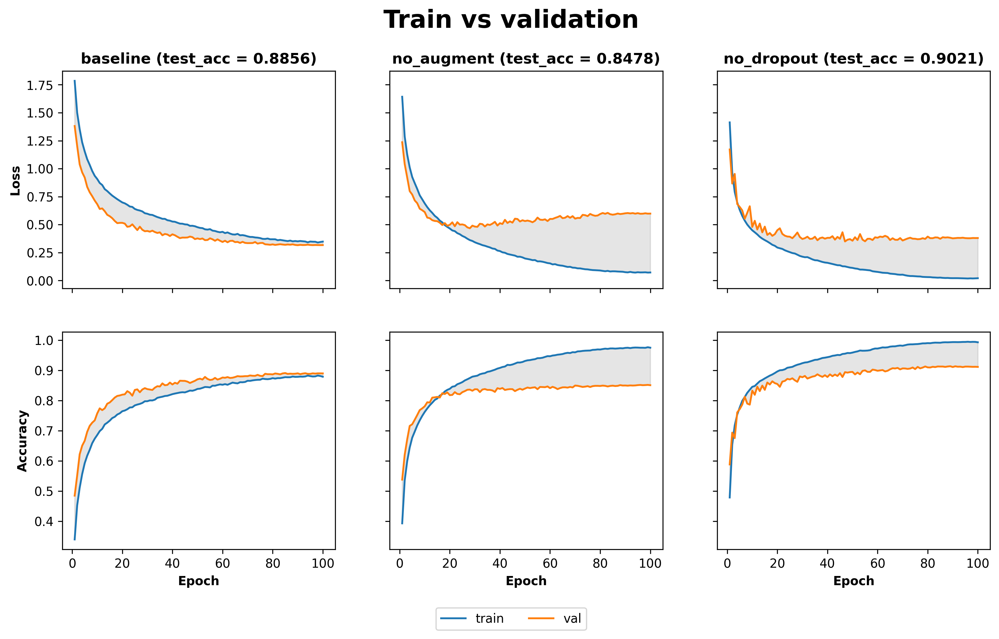

# CIFAR-10 Image Classifier

An end-to-end deep learning project in PyTorch: a CNN trained from scratch on CIFAR-10, comparison experiments on regularization, a FastAPI service, and an in-browser demo.

## Live Demo

**Try it here: https://mengyi-an.github.io/image-classifier/**

Click the link to try the model in your browser. You can pick one of the example images from the CIFAR-10 test set, or upload your own picture. The page shows the predicted class and the top-3 probabilities.

The trained model (90.2% test accuracy) is exported to ONNX and runs fully in your browser with ONNX Runtime Web, so no server is needed and your images are never uploaded anywhere.

Note: the model was trained on small 32×32 images of 10 classes (airplane, automobile, bird, cat, deer, dog, frog, horse, ship, truck). It works best on simple, centered pictures of these classes, and may be wrong on high-resolution photos.

## What This Project Does

- **Data pipeline:** torchvision datasets and transforms, data augmentation (random crop, horizontal flip), and a fixed 45k / 5k / 10k train / validation / test split
- **Model and training:** a custom CNN (`nn.Module`) with batch normalization and dropout, trained with a hand-written training loop, Adam, weight decay and cosine learning rate scheduling
- **Experiment tracking:** hyperparameters and per-epoch metrics logged with MLflow; the best epoch is chosen on the validation set and the test set is used only once
- **Comparison experiments:** a baseline and two comparison runs (without data augmentation, without dropout)
- **Deployment:** a FastAPI REST service (Docker) and an ONNX export that runs in the browser, hosted on GitHub Pages
- **Engineering:** fixed random seeds for reproducible runs, pytest tests, and GitHub Actions CI

## Results

All runs were trained for 100 epochs with the same seed and the same validation set.

| Run | Data augmentation | Dropout | Best val acc | Test acc |
|---|---|---|---|---|
| baseline | yes | yes | 89.12% | 88.56% |
| no_augment | no | yes | 85.20% | 84.78% |
| **no_dropout** | yes | no | **91.38%** | **90.21%** |



- **Data augmentation matters most.** Without it, the model fits the training set almost perfectly while validation loss starts rising after about 25 epochs, a clear sign of overfitting.
- **Dropout slowed learning in this setup.** Together with augmentation it regularized the model too strongly. Removing it gave the best accuracy, though its validation loss is higher, meaning the model is more overconfident on the images it gets wrong.
- **The final model is `no_dropout`**, selected by validation accuracy. Each run used a single seed, so small differences should be read with care.

## Project Structure

```
src/
  model.py         CNN architecture
  train.py         training, evaluation and MLflow logging
  plot.py          learning curves of several runs side by side, plus a summary table
  serve.py         FastAPI service
  export_onnx.py   export to ONNX for the browser demo, with a check against PyTorch
docs/              the browser demo (GitHub Pages)
tests/             API tests
figures/           result plots
```

## How to Run

Install the dependencies (Python 3.11):

```bash
pip install -r requirements.txt
```

Train the baseline and the two comparison runs, then plot them:

```bash
python -m src.train                  # baseline -> data/model.pt
python -m src.train --no-augment     # -> data/comparison/no_augment/
python -m src.train --no-dropout     # -> data/comparison/no_dropout/
python -m src.plot                   # -> figures/comparison.png
```

CIFAR-10 is downloaded automatically on the first run. Trained weights are not committed to the repository.

Export a trained model for the browser demo (needs `pip install onnx==1.17.0 onnxruntime`):

```bash
python -m src.export_onnx --model data/model.pt
```

Start the API locally:

```bash
uvicorn src.serve:app --reload        # API docs at http://localhost:8000/docs
```

Or with Docker (the model is mounted at runtime):

```bash
docker build -t image-classifier .
docker run -p 8000:8000 -v "$(pwd)/data:/app/data" image-classifier
```

Run the tests:

```bash
pytest tests/
```

## API Endpoints

| Method | Path | Description |
|---|---|---|
| GET | `/health` | check that the service is ready |
| GET | `/classes` | list the 10 classes |
| GET | `/classes/{name}` | describe one class |
| POST | `/predict` | classify one image (`top_k`, `min_confidence` optional) |
| POST | `/predict/batch` | classify up to 20 images |

## License

MIT
