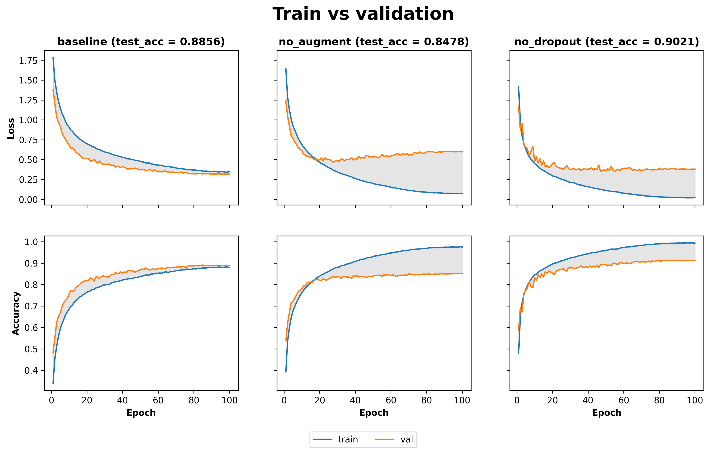

# CIFAR-10 Image Classifier

A CNN trained from scratch on CIFAR-10 with PyTorch, with comparison experiments and an in-browser demo.

**Live demo: https://mengyi-an.github.io/image-classifier/**

Pick an example image or upload your own to see the top-3 predictions. The model runs in your browser with ONNX Runtime Web, so no server is needed. It was trained on 32×32 images of 10 classes and works best on simple, centered pictures.

## Features

- Custom CNN with batch normalization, trained with a hand-written PyTorch loop
- Data augmentation (random crop, horizontal flip) and a fixed train / validation / test split
- Experiment tracking with MLflow; the test set is used only once, on the best epoch
- Browser deployment via ONNX export on GitHub Pages

## Results

All runs were trained for 100 epochs with the same seed.

| Run | Augmentation | Dropout | Val acc | Test acc |
|---|---|---|---|---|
| baseline | yes | yes | 89.12% | 88.56% |
| no_augment | no | yes | 85.20% | 84.78% |
| **no_dropout** | yes | no | **91.38%** | **90.21%** |



- **Data augmentation matters most.** Without it, the model overfits after about 25 epochs.
- **Dropout hurt in this setup.** Combined with augmentation it over-regularized the model, so the final model is `no_dropout`.

## Project Structure

```
src/
  model.py         CNN architecture
  train.py         training, evaluation and MLflow logging
  plot.py          learning curves of several runs side by side, plus a summary table
  export_demo.py   export to ONNX for the browser demo, with a check against PyTorch
docs/              the browser demo (GitHub Pages)
figures/           result plots
```

## Usage

```bash
pip install -r requirements.txt

python -m src.train                  # baseline
python -m src.train --no-augment     # comparison runs
python -m src.train --no-dropout
python -m src.plot                   # -> figures/comparison.png

python -m src.export_demo            # export to docs/ (needs onnx==1.17.0 onnxruntime)
```

CIFAR-10 is downloaded automatically on the first run.

**No GPU?** Training 100 epochs on a CPU is slow, so you can run it on [Google Colab](https://colab.research.google.com/) with a free GPU (Runtime → Change runtime type → T4 GPU). Clone the project into Google Drive so the results are kept after the session ends:

```python
from google.colab import drive
drive.mount('/content/drive')
%cd /content/drive/MyDrive
!git clone https://github.com/Mengyi-An/image-classifier.git
%cd /content/drive/MyDrive/image-classifier
!pip install -q mlflow     # Colab already has PyTorch with GPU support
!python -m src.train
```

## License

MIT
